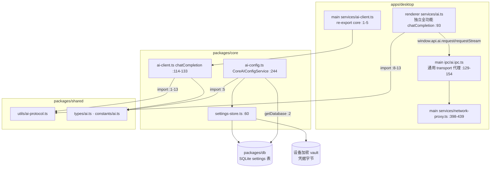

# AI Provider / 模型接入 · 现状架构 + 本地推理引擎选型 + 二开方向

> **派生 · 非权威 · 引用权威主题。** 本文是二开理解层的派生记录，不构成需求或实现约定。
> 权威需求与 API 基线见：[AI provider API 矩阵](../../reference/ai-provider-apis.md) · [系统规范](../../context/system.md) · [桌面行为](../../behavior/desktop.md) · [存储架构](../../structure/storage-architecture.md)。
> 设计依据：[component-understanding-kb 设计](../../../changes/active/component-understanding-kb/design.md)（"文档语言与抽象层级"节）。
> 现状输入：[flow.md](flow.md)（Task 3 流程图，已逐节点核对）。证据基线：main @ `7e69e6f7` 工作区，所有 `文件:行号` 经本会话直接读码核对。
> 引擎调研更新（2026-11-16）：第二部分已按 [R0] 调研报告 + Qwen 官方模型卡 [R1] + llama.cpp 上游代码 [R2] 更新，**含对本模型架构假设的明确纠正**（§2.0）；LM Studio 已被用户删除，不再列为可用选项。用户新增四条约束（留余量 / ComfyUI 共存 / tok/s 监控 / 工具流与提示词加载优化）落入 §3.3（意图级）。
>
> **抽象层级约定**：第一部分是他人稳定成熟代码的**现状照实记录**，可含具体接口/调用关系；第三部分是我们**二开的方向**，只写意图与约束，**不预设代码接口和上下级调用结构**（后续可能大修）。第二部分引擎选型是外部技术调研，每项附来源。

---

## 第一部分 · 现状架构

### 1.1 组件职责与依赖方向

AI 模型 provider 线横跨三个包，依赖方向严格单向 **desktop → core → shared**，desktop 也直接复用 shared；存储原语在 db。

| 层 | 组件 | 职责 | 关键证据 |
| --- | --- | --- | --- |
| shared | `packages/shared/utils/ai-protocol.ts` | 协议推断 + endpoint/鉴权/URL 标准化的**唯一真相源**，三端复用 | `resolveAIProtocol:23-45`、`buildChatEndpointFromBase:80-95`、`buildHeadersForProtocol:122-144` |
| shared | `packages/shared/types/ai.ts` | 跨进程可序列化契约：`AIProtocol`、`AITransportRequest/Response` | `:23`（`"openai"\|"gemini"\|"anthropic"`）、`:13-21`、`:25-32` |
| shared | `packages/shared/constants/ai.ts` | 统一请求 deadline | `:2` `AI_REQUEST_TIMEOUT_MS = 300_000` |
| core | `packages/core/src/ai-config.ts` | provider/model 配置归一化、增删、路由能力校验、持久化编排 | `CoreAIConfigService:244`、`normalizeProtocol:104-134`、`assertRouteCompatible:443-473` |
| core | `packages/core/src/ai-client.ts` | **非流式** chat 编排（仅 rules 重写 / skill 安全扫描用），transport 可注入 | `chatCompletion:114-133`、`requestWithFetch:30-50` |
| core | `packages/core/src/settings-store.ts` | 设置值与凭据引用的存储所有权（SQLite + 设备加密 vault） | `:59` 所有权注释、`read:118-136`、`patchSettings:138-141` |
| db | `@prompthub/db`（`getDatabase`/`SettingsDB`） | SQLite schema/adapter/设置表存储原语 | `ai-config.ts:2` 导入 `getDatabase`；`settings-store.ts:69` `new SettingsDB` |
| desktop main | `apps/desktop/src/main/ipc/ai.ipc.ts` | **通用 HTTP transport 代理**（不 import core），统一超时/multipart 校验/代理 | `performRequest:129-154`、`fetchWithNetworkProxy` 调用 `:144` |
| desktop main | `apps/desktop/src/main/services/ai-client.ts` | 纯 re-export `@prompthub/core` 的 chatCompletion | `:1-5` |
| desktop main | `apps/desktop/src/main/services/network-proxy.ts` | 系统代理走 Chromium session.fetch；manual 模式替换全局 fetch | `fetchWithNetworkProxy:398-430`、`applyGlobalFetch:432-439` |
| desktop renderer | `apps/desktop/src/renderer/services/ai.ts` | **功能更全的独立 chat 编排**（流式/思考模式/token 参数回退），只复用 shared 协议工具 | `chatCompletion:93`、shared 导入 `:8-13`、Qwen `enable_thinking:237-254` |

依赖方向核对：core 只 import shared/db（`ai-client.ts:1-13`、`ai-config.ts:2,5`），不 import 任何 desktop；renderer/main 可 import shared 与 core，反向不存在。符合 AGENTS.md §8.7 包边界。

### 1.2 数据所有权：provider 配置存哪

- **结构化配置**（provider/model/路由）以三个设置键持久化：`aiProviders`、`aiModels`、`modelRouteDefaults`。读：`ai-config.ts:259-261`；写：`ai-config.ts:275-278`（经 `CoreSettingsStore.patchSettings`）。
- **存储介质**：SQLite settings 表存**值与凭据引用**；**设备加密 vault 存凭据字节**。所有权注释见 `settings-store.ts:59`（"SQLite owns values and references; the vault owns device-encrypted credential bytes"），构造与迁移 `:60-90`，读取解码 `:118-136`。
- **配置形状**：`CoreAIProviderConfig`（`ai-config.ts:25-33`：id/name/provider/apiProtocol/apiKey/apiUrl/lastVerifiedAt）与 `CoreAIModelConfig`（`:35-48`：另含 type/model/isDefault/capabilities）。`apiProtocol` 是合法枚举，`apiKey`/`apiUrl` 为字符串字段。
- **归一化保证**：无论 CLI 新增（`addProvider:298-317`/`addModel:333-375`）、整体写入（`write:266-281`）还是读旧数据（`read:252-264` → `parseCoreAIConfig:219-242`），都经同一组 `normalize*` 纯函数，落盘与读出形状一致。
- **路由能力校验**：`setRoute:398-412` 经 `assertRouteCompatible:443-473` 拒绝能力不匹配模型（如 visionText 必须 `capabilities.vision===true`），失败抛 `ROUTE_CAPABILITY_MISMATCH`。

> 含义：本地引擎作为一个新 provider/model 接入时，其 base URL、协议、（占位）key、model 名都落在现有 `aiProviders`/`aiModels` 设置键里，无需新存储布局。这是现状事实，不是本文提出的改动。

### 1.3 关键抽象：shared ai-protocol 工具族

endpoint/鉴权/URL 标准化全部下沉 shared，core 与 renderer 共用，不重复实现（权威基线 [ai-provider-apis.md](../../reference/ai-provider-apis.md) Stable Asset Rules 要求三端复用）。

| 工具 | 行为 | 证据 |
| --- | --- | --- |
| `resolveAIProtocol` | 显式枚举优先；否则 provider **全等** `anthropic`/`google`/`gemini` 或 URL 含官方域名才判协议，**兜底 openai** | `ai-protocol.ts:23-45`（兜底 `:44`） |
| `getBaseUrl` | 剥离已知端点后缀（`/chat/completions`、`/completions`、`/models`、`/embeddings`、`/images/generations`），用户填完整端点或 base 都可 | `:15-21`、`:47-58` |
| `resolveProtocolBase` | `apiUrl` 以 `#` 结尾 → `explicit=true`，端点原样使用不再拼装 | `:70-78` |
| `buildChatEndpointFromBase` | openai：base 以 `/v数字` 结尾 → `+/chat/completions`，否则 `+/v1/chat/completions`；anthropic/gemini 各有规则 | `:80-95`（openai `:92-94`） |
| `buildHeadersForProtocol` | openai/gemini 默认 `Authorization: Bearer`；anthropic `x-api-key`+版本头；gemini 仅 `useNativeGeminiAuth` 选项下用 `x-goog-api-key` | `:122-144` |

**对本地接入的意义**：任意 `http://localhost:<port>/v1` 形式的 base 都会落入 openai 分支并正确拼出 `/v1/chat/completions`；`#` 显式端点可覆盖任何非标准路径。协议工具本身已为本地 OpenAI 兼容端点留好通路。

### 1.4 两条聊天执行路径 + 协议推断双实现（Task 3 高价值发现）

现状**不是**"renderer → main → core chatCompletion"单链，而是两条并存路径 + 两份协议推断：

1. **路径 A（交互式聊天主路径）**：renderer `services/ai.ts:93` 独立全功能编排（流式、思考模式、`max_completion_tokens` 自动选择 `:148-155`、Qwen `enable_thinking:237-254`），经 `window.api.ai.request/requestStream` → main `ai.ipc.ts` 通用 transport 代理（`performRequest:129-154`）→ `fetchWithNetworkProxy:144`。**不调用 core chatCompletion**，只复用 shared 协议工具（`:8-13`）。
2. **路径 B（后台 AI 功能）**：main 的规则重写 / Skill 安全扫描经 `services/ai-client.ts:1-5` re-export 调 core `chatCompletion:114-133`，用自带 `requestWithFetch:30-50`（**裸 fetch** + AbortController），**不经过 ai.ipc.ts**。core 客户端只做非流式（`buildChatBody:76` `stream:false`）。
3. **代理差异**：路径 A 的 `fetchWithNetworkProxy` 在 system 模式走 Chromium `session.defaultSession.fetch`（`network-proxy.ts:404-409`）；路径 B 的裸 fetch 在 system 模式**不走 Chromium 代理**，仅 manual 模式经 `applyGlobalFetch` 替换 `globalThis.fetch`（`:432-439`）间接获得代理。两条路径网络行为不一致。
4. **协议推断双实现**：core `normalizeProtocol`（`ai-config.ts:104-134`，**子串**匹配，含 `claude`/`google` 别名）用于**配置归一化**；shared `resolveAIProtocol`（`ai-protocol.ts:23-45`，provider **全等**匹配）用于**运行时聊天**。两者兜底都是 openai，但别名覆盖范围不同。对 localhost/自定义端点两者都无特殊分支，一律落 openai 兜底。

> 这些是现状事实与差异，不是本文提出的改动。是否收敛双实现/统一代理行为留给 [todo.md](todo.md)（已建，Task 5）评估。

### 1.5 现状对本地接入的契合点与摩擦点（仅事实）

| 维度 | 现状 | 证据 |
| --- | --- | --- |
| 协议契合 | 本地 OpenAI 兼容端点自然落 openai 分支，端点拼装支持任意 base 与 `#` 显式端点 | `ai-protocol.ts:44`、`:80-95`；`ai-config.ts:133` |
| **apiKey 强校验** | core 与 renderer 聊天入口都**强制非空 apiKey**，缺失即 throw | `ai-client.ts:120`；renderer `ai.ts:106-108` |
| 超时 | 固定 300s；core 路径写死不可按调用覆盖，renderer 路径可经 `options.timeoutMs` 覆盖 | `constants/ai.ts:2`；`ai-client.ts:130`；`ai.ts:104` |
| 流式 | 仅 renderer 路径 A 支持流式/思考；core 路径 B 恒非流式 | `ai.ts:131,246-247`；`ai-client.ts:76` |
| 重试 | 聊天调用一次性失败即抛错，无自动重试（renderer token 参数回退属 Issue #21 模型兼容逻辑） | `ai-client.ts:98,108-110`；`ai.ts:145-155` 注释 |
| 旁路划界 | `agent-qwen-definition.ipc.ts`、`agent-model-*`/`agent-provider-*` 属 **coding-agent 平台适配线**，非本地 GGUF 推理接入点 | 见 [flow.md](flow.md) §0 |

**摩擦点本质**：本地引擎通常不校验 key，但**接受任意非空占位 key**（见第二部分来源）。因此现状的"强制非空 apiKey"对本地端点是**可绕过的 UX 摩擦**（填占位值即可通过），而非硬阻断；真正需要二开决策的是"是否让本地 provider 免填 key"。此判断的依据在第二部分引擎调研，方向在第三部分。

---

## 第二部分 · 本地推理引擎选型对照

### 2.0 硬件与模型前提（用户实际目标）

- **模型**：根目录 `Qwen3.5-9B-The-Defiant-Fable-Uncnr-Heretic-NEO-MAX-IQ4_XS.gguf`，实测 `6,396,325,152` 字节 ≈ **6.4 GB（十进制）/ 5.96 GiB**，IQ4_XS 量化（约 4.25 bit/weight 档）。根目录另有 `...-MTP-IQ4_XS.gguf`（≈6.5 GB，带 MTP 多 token 预测草稿头变体）。MTP 的引擎支持**已核实**（llama.cpp 原生 `--spec-type draft-mtp`，KVMem llama.cpp 后端亦支持，§2.2 [R2][R3]）；但本 heretic/merge 变体的草稿头接受率与净收益**须本机实测**，接受率 <50% 时换普通 IQ4_XS 变体（用户两个文件各司其职，§2.2 MTP 专项）。
- **硬件**：约 **8 GB 显存 + 32 GB 内存**（显卡具体型号未知，RTX 20/30/40/50 之一，带宽/内核差异大，须先确认 sm 版本选对应 CUDA 包 [R0]）。
- **用户约束（新增）**：显存/内存**不得被引擎+模型占满**，须给系统与其他应用留余量（参考目标总占用 ~6–6.5 GB / 8 GB，非硬阈值）；未来同一显卡还要与 ComfyUI 生图共存。约束全文见 §3.3，对推荐的影响见 §2.2。

#### 2.0.1 架构纠正（已核实，更正本文此前假设）

> **纠正声明**：本文此前版本依据通用 8GB 指南 [S22]，把该模型当作"KV 紧张的稠密 9B 全注意力模型"。Qwen 官方模型卡 [R1] 与 llama.cpp 上游代码 [R2] 确认：**Qwen3.5-9B 是混合架构，KV 压力约为同尺寸纯注意力模型的 1/4**，"KV 紧张"前提被大幅缓解。以下为已核实事实。

- **32 层 = 24 层 Gated DeltaNet（GDN，线性注意力）+ 8 层全注意力**。Hidden Layout：`8 × (3 × (GDN → FFN) → 1 × (Gated Attention → FFN))`。**只有这 8 层全注意力产生随上下文增长的 KV cache**；24 层 GDN 的循环状态大小与上下文长度无关。[已验证：R1 模型卡架构段；R2 `src/models/qwen35.cpp`（"Qwen3.5 does not use MoE FFN"，含 MTP block 张量）、`conversion/qwen.py`、`src/llama-model.cpp`（hybrid MTP context：nextn 层用独立普通 KV cache）]
- 全注意力层：**KV 头 4、head_dim 256**（Q 头 16，RoPE 维 64）；GDN：V 头 32 / QK 头 16，head_dim 128。FFN 稠密（非 MoE），hidden 4096 / FFN 12288。[已验证：R1]
- **原生上下文 262,144（256K），可扩展至 ~1M**；**MTP 为多步训练的原生草稿头**；词表 248,320（padded）。[已验证：R1]
- **视觉**：早融合多模态，GGUF 需**另配 mmproj** 才能看图（且 MTP×mmproj 暂不兼容的说法为二手，须复核，§2.2）。[已验证：R1；限制为二手]

**KV cache 占用推算** [推算，基于 R1 已验证参数；R0 §1.2]：每 token KV 仅来自 8 个全注意力层：8 层 × 4 KV 头 × 256 维 × 2(K+V) = 16,384 个值。

| KV 精度 | 每 token | 32K ctx | 128K ctx | 256K ctx |
| --- | --- | --- | --- | --- |
| f16 | ≈32 KB | ≈1.0 GB | ≈4.0 GB | ≈8.0 GB |
| **q8_0** | **≈17 KB**（含 block scale） | **≈0.53 GB** | **≈2.1 GB** | **≈4.4 GB** |
| q4_0 | ≈9 KB | ≈0.28 GB | ≈1.1 GB | —（质量/接受率风险更高） |

另有 GDN 循环状态 ≈**50 MB/序列（FP32，恒定，不随上下文增长）**+ 小卷积状态。对比：同尺寸纯全注意力 32 层模型的 KV 是上表的 **4 倍**。

**为什么 IQ4_XS 文件有 6.4GB（比一般 9B Q4 大）**：DavidAU 卡自述所有量化均 NEO imatrix（宣称精度 +2–4%），且 **output tensor 改为 16bit 全精度**；词表 248,320 × 4096 × 2B ≈ 2.0 GB 的输出头 + 大词表嵌入解释了体积。[自述：R1；体积构成推算：R0 §1.3] MTP 变体的草稿头张量为 Q8_0，增量 ≈0.1–0.2GB [推算]。

**8GB 显存预算表** [推算，R0 §1.4]：

| 项目 | 估算 |
| --- | --- |
| 权重（IQ4_XS，全 offload） | ~6.4 GB |
| CUDA context + 计算缓冲（FA、batch 512–2048） | ~0.5–0.9 GB |
| MTP 草稿头 + nextn KV + 草稿验证缓冲（若启用） | ~0.2–0.4 GB（KVMem 27B 实测增量 +0.56 GiB，9B 应更小） |
| 剩余给主 KV | ~0.3–0.9 GB（未计桌面占用） |

- 按纯技术上限：q8_0 KV 下 **16K 稳、32K 有希望**；f16 KV 只能 ~8–16K；64K+ 需 KV 分层（KVMem）或减层 offload。**须实测**。
- **但按用户留余量约束（§3.3），推荐目标总占用 ~6–6.5GB，上表"全 offload + 缓冲"已超目标**——取舍见 §2.2，不能默认"-ngl 99 占满 8GB"。
- Windows WDDM 桌面占用再吃 0.3–1GB，**实际可用显存以 nvidia-smi 为准**；RTX 20/30/40/50 缓冲与内核支持不同（NVFP4 内核仅 sm_120/RTX50，int8 路径 sm_75+），不能假设同一配置四系通用。[R0]
- 权重 + KV 共享显存，装不下溢出到系统内存走 PCIe 显著降速，无处可溢则崩溃；32GB 内存提供 CPU offload 兜底与 KVMem 式 KV 分层空间（§2.2）。[S22 通用机制仍成立；其"KV 紧张"程度已被混合架构纠正]

**通用前提**：候选引擎（llama.cpp / KVMem / Ollama / KoboldCpp）都吃 GGUF、都暴露 OpenAI 兼容 `/v1/chat/completions`，与 PromptHub 现有 openai 协议接入契合度都高；差异在控制粒度/性能/长上下文策略/部署复杂度。模型卡确认 Ollama/KoboldCpp 等可直载 GGUF、聊天模板内嵌于文件 [S24]。**LM Studio 已被用户删除，不再列为可用选项**（历史来源 [S17]–[S21] 仅存档）。

### 2.1 引擎选型判定表（2026-11 调研更新）

> 本表是 [R0] 调研（一手仓库代码/文档/发布说明 + 官方模型卡）后的判定层，**替换原"四引擎对照表"**。每格附来源；证据分级沿用 [R0]：**已验证**=一手材料可核对；**自述**=作者/项目宣称；**二手**=博客转述；**推算/推断**=基于一手参数的推导/判断。原四引擎对照中可交叉验证的机制事实（端点、GGUF 直载、旋钮、并发模型）仍见 [S1]–[S16][S25][S26]。"契合度"指与 PromptHub 现状 openai 分支 + 强制非空 apiKey + 300s 超时 + 可配置 base URL 的匹配程度。

| 引擎 | 判定 | 关键依据 | 证据等级 / 来源 |
| --- | --- | --- | --- |
| **llama.cpp（llama-server）** | ✅ **首选**（日常 ≤32K） | **原生支持 Qwen3.5 dense hybrid + 原生 MTP（`--spec-type draft-mtp`）**；KV 量化 / FlashAttention / 部分 offload 全套旋钮；GGUF 直载无需转换；Windows 预编译包；server 单元测试即用 Qwen3.5-4B-MTP | 已验证（代码 + docs + tests）[R2][S1][S2][S4] |
| **KVMem**（llama.cpp 后端） | ✅ **长上下文（64K–256K）首选** | 直读 GGUF 无需转换；GPU 只留固定 token 的 KV 预算，完整 KV 历史放 RAM（可选 SSD），按需检索回填不重算；GDN 层走原生 recurrent memory；OpenAI 兼容 API + 控制台。**9B 已本机源码构建（CUDA 13.5/sm_120a）并实测：20K 上下文（超 16K GPU 预算）needle 召回正确、显存锁定 ~7.3GB、decode 47 t/s**（[benchmark-results.md](benchmark-results.md)）；官方对 9B 原仅形状级验证，本实测补缺口。RTX 20/30/40 预编译包"已编译验证、未上卡实测" | 已验证（README 表、`docs/qwen35-dense-family.md`、v0.19.1 release）[R3] + **本机 9B 实测** |
| **Ollama** | ⚠️ 务实备选 | 可跑本模型 GGUF（Modelfile 导入）；≥v0.32.6 对原生 MTP 头自动投机解码（二手，版本/后端须验证）；显存/KV 控制粒度粗，**留余量预算难精确落实**；上下文须经 Modelfile 而非 API | 二手 + 自述 [R0][S8][S9][S11] |
| **KoboldCpp** | ⚠️ 特定场景备选 | 零安装单文件、Vulkan 对 AMD/旧硬件更稳；Qwen3.5 MTP 支持状态**未验证**；AGPL 许可嵌入需法务自查；非高并发定位 | 部分未验证 [S13]–[S16][R0] |
| **NInfer**（KVMem 后端之一） | ⚠️ **二期实验** | 支持 Qwen3.5 Dense 9B，但为 `.ninfer` 自有格式，**自定义 heretic merge 的 GGUF→.ninfer 转换兼容性未知**；专用内核（int8/NVFP4）与 DFlash2 草稿的现有记录均为 27B，对本模型收益未知。先 llama.cpp 后端，转换成功且 identity 对齐后再比速度 | 已验证（上游仓库存在，经 KVMem docs 引用确认）[R5]；转换可行性=未知 |
| **Strata** | ❌ **不适用** | Qwen3.8-Flash-Next（qwen4exp MoE）专用引擎，自有 pack 格式；代码注释明确区分 qwen3.5 GDN（SiLU）与其目标架构（sigmoid）；dense 构建变体仅 Qwen3.8-27B；**未发现 Qwen3.5-9B dense 支持路径** | 已验证（代码搜索）+ 推断（置信度高）[R4] |
| **PowerInfer / PowerInfer-2** | ❌ 不适用 | 需 ReLU 系稀疏激活模型；SwiGLU 系可剪枝稀疏度仅 40–53%；Qwen3.5 GDN hybrid 无支持证据 | 已验证（论文解读一致）+ 推断 [R0] |
| **AirLLM** | ❌ 不适用 | 逐层从磁盘/RAM 流式加载，速度秒级/token；目标是"能跑"不是"跑快"，与 tok/s 目标相反 | 二手 + 推断 [R0] |
| **FlexGen / DeepSpeed-Inference** | ❌ 不适用 | 离线批处理/数据中心定位；无 Qwen3.5 消费级 Windows 路径 | 二手 + 推断 [R0] |
| **vLLM / SGLang** | ⚠️ 支持但**不实用** | 官方支持 Qwen3.5 MTP（vLLM `qwen3_next_mtp`、SGLang NEXTN），但 vLLM Windows 原生不支持、GGUF 支持弱、8GB 单用户场景开销大（除非 WSL2 实验） | 已验证（官方卡命令）+ 二手 + 推断 [R0] |
| **LM Studio** | — **已移除** | **用户已删除 LM Studio，不再列为可用选项**；原"调参/验证辅助"推荐撤销。历史来源 [S17]–[S21] 仅存档（其中 [S20] 的占位 key/CORS 等通用事实仍被引用） | 用户决策（2026-11） |

**可行候选的关键机制速览**（保留原对照表中可交叉验证的事实）：

| 维度 | llama.cpp | KVMem（llama.cpp 后端） | Ollama | KoboldCpp |
| --- | --- | --- | --- | --- |
| OpenAI 兼容端点 | 原生 `/v1/chat/completions` 等，另有 Anthropic 风格 `/v1/messages` [S1] | OpenAI 兼容 API + 控制台/聊天 UI [R3] | `http://localhost:11434/v1` [S8][S11] | 默认 5001，`/v1`（`--jinja` 才正确套模板）[S15][S26] |
| GGUF 直载 | `-m model.gguf` [S2] | 直接选 GGUF，无需转换 [R3] | Modelfile `FROM ./model.gguf` [S9][S10] | `--model model.gguf` 单文件 [S13][S14] |
| 显存/上下文关键旋钮 | `-ngl` / `-fa` / `-ctk/-ctv`（KV 量化）/ `-c` / `-b/-ub`，粒度最细 [S4] | GPU KV 预算 B + 生成预留 R + sink/recent 保留 + HostMiB（RAM 预算）[R3][R0] | `num_ctx` 经 Modelfile；KV/flash 经环境变量，旋钮少 [S8][S12] | `--gpulayers` / `--contextsize` / `--batchsize` [S14][S16] |
| 占位 key 满足现状非空校验 | 可（`--api-key` 可选）[S25] | 可（本地不校验）[R0] | 可 [S11] | 可 [S26] |

### 2.2 推荐与理由（按用户留余量约束更新）

**日常首选（≤32K）：最新 llama.cpp（CUDA，llama-server）**

1. **原生支持已核实**：Qwen3.5 dense hybrid + 原生 MTP（`--spec-type draft-mtp --spec-draft-n-max N`），KV 量化 / FlashAttention / 部分 offload 全都有；server 单元测试即用 Qwen3.5-4B-MTP [R2]。**旧版 llama.cpp 会静默忽略 MTP 张量（无加速也无报错），必须用新版** [R0]。
2. **控制粒度最细，是落实"留余量预算"的前提**：`-ngl / -fa / -ctk/-ctv / -c / -b/-ub` 全套旋钮可逐项控制占用 [S4]；Ollama/KoboldCpp 粒度较粗，预算难精确落实。
3. **直载用户的确切 GGUF**（含自定义 uncensored merge 与 MTP 变体），无需转换/导入 [S2]。
4. **参考引擎，天然可替换**：Ollama 是 Go 封装 llama.cpp [S12]，KoboldCpp 推理封装在 `kcpp_src/` [S15]，KVMem 主力后端即 llama.cpp [R3]。以其为基线，切换引擎基本只换 base URL/端口。

**留余量预算（用户约束，取代"占满 8GB"式调参）**：
- 目标总占用参考 **~6–6.5 GB / 8 GB**（给系统桌面 WDDM 0.3–1GB 与其他应用留余量；参考值非硬阈值，以 nvidia-smi 实测为准）。**推荐不再是"-ngl 99 占满 8GB"**——[R0] 原推荐的全 offload 占满思路按用户约束收紧，取舍记录如下。
- **张力（如实记录）**：权重 6.4GB 全 offload + CUDA/计算缓冲 0.5–0.9GB 已 ~7GB 起，超出 ~6.5GB 目标。须在"部分层 offload（CPU 层每 token 走 PCIe，decode 掉速）/ 更紧上下文（q8_0 KV，先 8K–16K）/ 关 MTP（省 ~0.2–0.4GB）"之间取舍，**具体组合由本机实测定，不在此预设结论**。32K 上限只在余量目标放宽或实测缓冲小于推算时才可达。
- **长上下文不挤显存**：64K+ 走 KVMem 把 KV 历史放 RAM（见下），而不是压缩余量硬塞显存。

**长上下文首选（64K–256K）：KVMem（llama.cpp 后端）**

- 原理：权重仍进 GPU；GPU KV 只留固定 token 预算（B，如 8K–16K）+ 生成预留（R）+ sink/recent 保留；完整 KV 历史无损存 32GB RAM，每轮按 query 检索相关块回填 GPU，不重算。GDN 层走原生 recurrent memory，MTP 有专门状态回放路径。256K q8_0 KV ≈4.4GB，RAM 容纳无压力（§2.0.1 推算）。直读 GGUF 无需转换；OpenAI 兼容 API。[R3][R0]
- **RAM 同样留余量（用户约束）**：32GB 减去系统/应用 ~6–8GB、模型 mmap 页缓存 ~6.4GB 后再定 HostMiB 预算（如 8GB 起，而非顶格 16GB）；KVMem 文档记录过 32GB 机器 RAM 压力使 decode 掉到 31.7 tok/s 的案例（项目记录）。RAM 足够时 SSD 层基本不需要，且会话缓存进程生命周期内有效、重启不恢复。[R0 §5]
- **前置验证（9B 验证缺口，不可跳过）**：官方对 9B 只做了配置/转换契约/数值/状态级测试，整模型 + MTP 实测只在 4B 完成 [R3]。先跑 identity 短问答（KVMem-on/off 贪心输出一致），再跑自己的多深度 needle 召回任务，最后才上生产负载；RTX 20/30/40 预编译包"未上卡实测"，须确认能正常推理。
- **代价（如实记录）**：不是无损长上下文，是"无损存储 + 有损注意力窗口"，长程召回依赖检索命中（retrieval miss 是 GO/NO-GO）；检索/回填有开销（27B 自测：预算覆盖工作集时 prefill −9.6% / decode −1.8%，预算不足触发检索时另有 stage-in 延迟；均为项目自测，须本机实测）[R6][R0]。短上下文不如 llama.cpp 裸跑。

**务实备选：Ollama**（最快跑通、省心、单用户；代价：粒度粗难落实留余量预算、MTP 自动化为二手说法须验证、上下文经 Modelfile）[S8][S11][R0]。**特定场景：KoboldCpp**（零安装/旧硬件/Vulkan；MTP 支持未验证、AGPL）[S13]–[S16]。

**不适用 / 不推荐**：Strata（架构不符，❌）、PowerInfer（激活函数不符，❌）、AirLLM/FlexGen（目标不符，❌）、vLLM/SGLang（支持 MTP 但 Windows+8GB+GGUF 不实用，⚠️）、ExLlama（不吃 GGUF 需重新量化）。**NInfer 列二期实验**（GGUF→.ninfer 转换对自定义 merge 兼容性未知，转换成功且 identity 对齐后再比速度）[R5][R0]。

**LM Studio：用户已删除，不再列为可用选项**。原"调参/验证辅助（GUI 显存可视化）"推荐撤销；显存可视化验证改用 nvidia-smi 实测落实。

#### MTP 专项分析（值得用，预期 1.2–1.6×，非 2–3×）

- **支持矩阵（已核实部分）**：llama.cpp 原生 `--spec-type draft-mtp`（docs/speculative.md、common/speculative.cpp、server 测试用 Qwen3.5-4B-MTP）[R2]；KVMem llama.cpp 后端同参数 + GDN 状态只合入被接受前缀（ReplaySSM）[R3]；vLLM/SGLang 官方支持但本场景不实用（§2.1）。Ollama ≥v0.32.6 自动投机为二手说法须验证。
- **收益证据（全部自述/项目自测，无第三方同硬件复现，须本机实测）**[R0 §4.2]：模型作者自述 5090 上 ~130→185+ t/s（≈1.4×，接受率 60%、2 token 草稿）；KVMem 27B 自测记录 1.5–1.7×（接受率 83–93%）；另一 27B heretic 变体作者实测仅 1.19×（散文）/1.28×（代码），草稿更长收益递减甚至归零。CSDN "2.5×/3×" 系列参数写法与上游不符，不采信。
- **本模型是 heretic/merge，接受率可能偏低**：草稿头对**未编辑基座**训练，abliterate/merge 偏移（本模型 KLD 0.0793、多阶段 merge）会降低接受率（二手明确警告）。**接受率 <50%（2 token 草稿）就换普通 IQ4_XS 变体**——用户两个文件正好各司其职。temp≤1、rep_pen=1 是 MTP 友好设置；**代码/结构化输出、低 temp 场景收益最大**（90%+ 接受率记录都在编程任务），高 temp 创作/角色扮演接受率进一步下降。
- **调参方向**：草稿长度 n_max 从 1 扫到 3（9B 验证更快、草稿相对成本更高，最优点可能更小）；**草稿 KV 用 F16**（KVMem 对照实验：草稿 KV 从 F16 改 Q8_0 使接受率 92.9%→75.9%、decode 35.2→31.1 tok/s，项目自测 [R6]）；主 KV 用 q8_0 省显存。
- **与留余量预算的冲突**：MTP 额外显存 ~0.2–0.4GB（9B 推算）挤压余量，"MTP + 更小上下文" vs "无 MTP + 更大上下文"需 A/B 实测取舍。
- **限制（二手，须本机复核当前版本）**：MTP 与 `--mmproj`（视觉）暂不兼容；MTP 下保持 `-np 1`（无并发批处理）。看图需另配 mmproj [R1]，二选一。
- **质量**：投机解码每个草稿 token 都由目标模型验证，理论上不改变输出分布（贪心/同采样下）；风险在速度与数值路径，不在"质量变差"（KVMem identity canary 佐证）[R0]。
- 本硬件 tok/s **已本机实测**（RTX 5060 Ti 8GB，llama.cpp b12445 CUDA 13.5，详见 [benchmark-results.md](benchmark-results.md)）：极速档 ngl99+MTP n_max2 短上下文（c8192）**~68 t/s**（固定提示 -n512 三次中位 68.3，区间 66.4–69.5），无 MTP 对照 56.8 t/s，**MTP 稳定 1.20×**（接受率 >50%）。**速度随上下文显著下降**：c16K 满上下文 62.6 t/s、c32K 满上下文 23.2 t/s（混合架构省 KV 内存但注意力算力随 context 增长）。峰值显存：短上下文 ~7.5GB、c32K 满 7.66GB（94%，极紧）。原"20–45 t/s 粗估"已被实测取代。

### 2.3 来源清单

**新增一手来源（2026-11 引擎调研，[R#]）**：

- **[R0]** 本地引擎调研报告（2026-11-16；方法：GitHub API 一手取证 + hf-mirror 模型卡抓取 + WebSearch；含 28 条来源清单与证据分级，本部分判定/推算的主要汇总来源）：`C:/Users/ghous/AppData/Local/Temp/prompthub-local-engine-research/report.md`（临时目录产物，关键结论与来源已摘录进本文持久化；完整来源清单见其 §9）
- **[R1]** Qwen 官方模型卡（嵌于 DavidAU 仓库，hf-mirror 抓取；**架构纠正的权威来源**：32 层 hybrid layout、KV 头 4/head_dim 256、词表 248320、原生 262144、MTP 原生草稿头、mmproj 视觉、NEO imatrix + output 16bit、采样建议、MTP 速度自述）：https://hf-mirror.com/DavidAU/Qwen3.5-9B-The-Defiant-Fable-Uncensored-Heretic-NEO-IMATRIX-MAX-MTP-GGUF
- **[R2]** llama.cpp 上游代码/文档（已验证）：`src/models/qwen35.cpp`（dense hybrid、MTP block 张量）、`conversion/qwen.py`、`src/llama-model.cpp`（hybrid MTP context）、`docs/speculative.md`、`common/speculative.cpp`、`tools/server/tests/unit/test_spec_methods.py`（Qwen3.5-4B-MTP）：https://github.com/ggml-org/llama.cpp
- **[R3]** KVMem（已验证）：README 后端/模型表、`docs/qwen35-dense-family.md`（**9B 仅形状级验证**的官方明示）、v0.19.1 release（双后端统一、RTX20–50 包"未上卡实测"声明）：https://github.com/kvmem/kvmem
- **[R4]** Strata 代码证据（已验证）：`include/strata/kernels/gdn.hpp`（"qwen3.5 used SiLU and this artifact does not" 注释）、`src/split/src/model.hpp`（FNX_MODEL=27b 仅 27B dense）：https://github.com/Niko1221/Strata
- **[R5]** NInfer 上游（经 KVMem `docs/ninfer-all-migration-validation.md` 引用确认存在；转换兼容性未知）：https://github.com/iamwavecut/ninfer-all
- **[R6]** KVMem MTP/开销/前缀复用自测记录（项目自测，数字须本机复现）：`docs/mtp-kv-controlled-experiment-2026-09-13.md`（草稿 KV F16 vs Q8_0 接受率）、`docs/milestones/v0.10.0.md` 及 v0.9.0-speed.log（27B MTP 1.5–1.7×、显存 +0.56GiB、61k 前缀复用 54s→1.2s）、`docs/task1-prefill-overhead-2026-09-25.md`（prefill −9.6% / decode −1.8%）：https://github.com/kvmem/kvmem/tree/master/docs

**历史引擎调研来源（[S#]，WebSearch 结果，保留供交叉引用）**：

> 注：**[S17]–[S21] 为 LM Studio 相关来源，因用户已删除 LM Studio 仅作存档**，不再支撑任何推荐；其中 [S20] 同时含 Ollama/vLLM 与"占位 key/CORS"通用事实，仍被 §1.5 与 todo.md D1 引用。[S22] 的通用显存机制事实仍有效，但其"稠密 9B KV 紧张"前提已被 [R1][R2] 纠正（§2.0.1）。

- **[S1]** llama-server 零门槛搭建 OpenAI 兼容本地推理服务（原生 `/v1/*` + Anthropic 面 + 连续批处理/slot/Prometheus）：https://m.blog.csdn.net/gitblog_00015/article/details/155470490
- **[S2]** llama.cpp 与 GGUF：本地大模型"裸引擎"（`-m` 直载 GGUF、`llama-server --port 8080`、`/v1/chat/completions` curl 验证）：https://jishuzhan.net/article/2108037581011443714
- **[S3]** llama.cpp / Ollama / LM Studio：本地 LLM 推理栈硬核拆解（服务层端点、LM Studio GGUF 目录/`lms`、1234/v1）：https://juejin.cn/post/7688657982648877090
- **[S4]** Qwen3.6-35B-A3B 各类 NVIDIA 显卡实测（IQ4_XS + `--cache-type-k/v q8_0` + `--flash-attn` + `-ngl 999` + `-c` 启动模板；先降 `-c` 再降 `-b/-ub` 的 OOM 排查顺序）：https://blog.csdn.net/weixin_35307279/article/details/168850415
- **[S5]** Ollama 换掉之后：vLLM 和 llama.cpp 该选哪个（`OLLAMA_NUM_PARALLEL=1`/队满 503、llama.cpp `--parallel` 槽位+连续批处理默认开启、M1 16GB Qwen3-4B 单请求/4 并发实测、v0.5.0 `llama serve` 改名）：https://m.toutiao.com/article/7692778277563400730/
- **[S6]** 本地部署大模型硬件配置指南（llama.cpp 比 Ollama 快 10–20%、`--split-mode layer`、LM Studio 显存可视化/弱并发/检测工具定位、三工具对比表）：https://blog.csdn.net/weixin_30607125/article/details/167453987
- **[S7]** 我以为 Ollama 够用（同硬件 llama.cpp 快 5–20%、Ollama 真实负载吞吐变平/延迟抖动/一个卡住请求拖垮整批、默认最多 4 并行内存吃紧降 1、0.4.0 无头守护进程+连续批处理、`ollama run hf.co/...` 直拉 GGUF）：https://m.toutiao.com/article/7688554221326565951/
- **[S8]** Ollama OpenAI 兼容官方文档镜像（`/v1/chat/completions`、`/v1/models`、OpenAI API 无 ctx 字段→Modelfile `PARAMETER num_ctx`、`ollama cp` 改名、兼容边界）：https://m.w3cschool.cn/ollamadocs/ollamadocs-api-openai-compatibility.html
- **[S9]** Ollama 命令完整手册（Modelfile `FROM ./model-file.gguf` 导入本地 GGUF、`ollama create -f`、REST API 11434 端点表）：http://test.runoob.com/ollama/ollama-appendix-commands.html
- **[S10]** Ollama README 镜像（Import from GGUF：Modelfile `FROM` 指向本地 GGUF 路径；7B 需 ≥8GB RAM 等硬件建议）：https://gitee.com/ai-big-model/ollama
- **[S11]** 大模型本地部署完全指南：2026 工具选型（Ollama 安装包+`ollama run`、OpenAI 兼容 `base_url=http://localhost:11434/v1`、`api_key="ollama"` 随便填、Modelfile 自定义）：https://www.juejin.cn/post/7688988203790614528
- **[S12]** Ollama 学习·同类技术横向对比（Ollama=Go+llama.cpp C++ 后端、并发弱缺乏连续批处理/PagedAttention、调优上限受限需回 llama.cpp、四方案定位表）：https://blog.csdn.net/qq_42850898/article/details/167267063
- **[S13]** KoboldCpp 单文件零安装多模态（免安装可执行、`--model` 直载 GGUF、localhost:5001、内置 Web UI + 本地 API）：https://m.blog.csdn.net/gitblog_00787/article/details/167491380
- **[S14]** KoboldCpp 单文件快速上手（`--gpulayers N` 默认 -1 自动、`--contextsize N`、`--batchsize N`、显存不够降层数/缩上下文、OpenAI/Ollama/A1111 兼容 API）：https://blog.csdn.net/gitblog_00313/article/details/167394606
- **[S15]** KoboldCpp 本地部署 GGUF 单文件方案（README API 表 OpenAI 兼容 `/v1`、`--jinja` 聊天模板、`kcpp_src/` 推理封装、`--usecuda/--usevulkan`、`oldpc`/`--noavx2`）：https://blog.csdn.net/gitblog_00062/article/details/168551424
- **[S16]** KoboldCpp 评测 2026（单文件零构建、Vulkan/oldpc 对 AMD/旧硬件更可靠、非多用户高并发生产定位、AGPL 许可嵌入商业产品需法务自查、与 Ollama/LM Studio/llama.cpp 场景对比）：https://www.promptquorum.com/zh/power-local-llm/koboldcpp-review
- **[S17]** LM Studio 官方文档（用 llama.cpp 跑 GGUF、Apple Silicon 另支持 MLX、本地/网络 OpenAI-like 端点、内置模型下载、MCP 客户端）：https://lm-studio.cn/docs/app
- **[S18]** LM Studio Setup Guide（`lms server start` 1234、`lms load --context-length`、`--gpu` 0–1/max/off、未指定则自动决定 offload、按模型保存加载默认值、Jinja/手动模板覆盖）：https://www.cognativ.com/blog/lm-studio-setup-guide/
- **[S19]** Hermes Agent 实践者参考指南（LM Studio 从元数据读上下文但许多 GGUF 默认报 2048/4096，须齿轮图标显式设 ≥16384/建议 32768 再重载；`lms server start` 1234、`lms load --context-length 32768`；keyless 本地用 "no-key-required"）：https://blakecrosley.com/zh-Hans/guides/hermes
- **[S20]** 零成本本地部署：LM Studio/Ollama/vLLM 选型及量化（GPU Offload 滑杆显存够拉满/不够逐步降、7B Q4 在 8GB 可全 offload、1234/v1、`api_key` 随便填非空本地不校验、CORS/局域网开关）：https://blog.csdn.net/weixin_42565865/article/details/170170840
- **[S21]** 本地部署大模型工具怎么选·四类方案对比（图形化桌面 LM Studio/Jan/GPT4All 并发弱、命令行轻量 Ollama/llama.cpp、重型服务化 vLLM/TensorRT-LLM 连续批处理、四类工具关系表）：https://m.blog.csdn.net/weixin_33158887/article/details/168712009
- **[S22]** Best Local LLM for 8GB RAM or VRAM in 2026（**核心硬件适配来源**：Qwen 3.5 9B Q4_K_M ~5.7GB 全 offload 8GB、9B Q4 权重 5–6GB/运行 6–7GB+、16K–32K 上下文需量化 KV、权重+KV 共享显存溢出→PCIe 降速/崩溃、4-bit KV ≈ 4× token、全 GPU 常驻 9B 优于更大模型 CPU offload、按运行时实测而非文件大小判断）：https://atomic.chat/blog/guides/best-local-llm-8gb
- **[S23]** 2026 大模型本地部署实战选型指南（个人用 Ollama/LM Studio、嵌入式/移动用 llama.cpp、生产服务用 vLLM/SGLang；llama.cpp 自编译/转格式/写脚本换极致控制与最高效率；硬件条件→工具对照表）：https://blog.csdn.net/weixin_29038345/article/details/169528785
- **[S24]** Qwen3.8-9B GGUF 模型卡（Ollama/LM Studio/Jan/KoboldCpp 下载 GGUF 直接加载、聊天模板内嵌于文件、推荐采样 temp=0.6/top_p=0.95/top_k=20；量化档→建议显存表）：https://ai.atomgit.com/hf_mirrors/empero-ai/Qwen3.8-9B-GGUF
- **[S25]** DeepSeek R1 本地部署：llama-server 配置（OpenAI 兼容接口要求 `Authorization: Bearer`，`--api-key "sk-xxx-local-dev"`、默认绑 127.0.0.1、`--ctx-size` KV 压力）：https://blog.csdn.net/weixin_28224217/article/details/167400064
- **[S26]** SillyTavern 本地模型实战（KoboldCpp `--model --ctx-size --n-gpu-layers --host --port 5001`、`--n-gpu-layers` 控制 GPU 卸载层数否则全塞 CPU、Ollama OpenAI 兼容地址 `127.0.0.1:11434/v1/chat/completions` + API Key 随便填非空 + model 名须与 `ollama list` 一致）：https://m.blog.csdn.net/weixin_29061997/article/details/165897417

> 来源可靠性说明：**[R1]–[R5] 为一手已验证材料**（官方模型卡 / 上游仓库代码、docs、release），架构与支持性结论置信度高；**[R6] 与所有性能数字均为项目自测记录或作者自述，无第三方同硬件复现，一律标注"自述/须实测"**；本硬件（8GB 卡 + 该确切 merge IQ4_XS）无任何公开实测数字，tok/s 与上下文上限为推算，置信度低，必须本机实测（§3.5）。历史来源中 [S8][S10] 为官方文档/README 镜像，[S22] 为英文专项硬件指南（其架构前提已纠正），其余为社区博客，只采信可交叉验证的引擎机制事实，不采信营销性性能数字。

---

## 第三部分 · 二开方向（意图级 · 不锁接口）

> 本部分只写**方向、目标、约束与取舍**，用自然语言描述。**不预设具体代码接口、函数签名、参数名或上下级调用结构**——后续可能大修，落到具体接口是实施阶段的事。现状依据见第一/二部分。

### 3.1 目标

让 PromptHub 自己的 AI 功能（聊天测试、改写、翻译、Skill 安全扫描、规则重写等）能够使用**用户本机运行的本地推理引擎**所加载的 Qwen3.5-9B IQ4_XS GGUF，做到**完全离线、流畅、稳定、在留余量约束下尽可能最优**，并且**引擎可替换**（llama.cpp / KVMem / Ollama / KoboldCpp 之间切换不改变 PromptHub 侧的接入方式；LM Studio 已被用户删除，不再是候选）。

### 3.2 方向

- **把本地引擎当作"又一个 openai 协议 provider"**，而不是新增一种协议或新的推理子系统。现状的通用 provider 抽象（协议枚举 + 可配置 base URL + 端点拼装）已经为本地 OpenAI 兼容端点留好通路（§1.3/§1.5），方向是**复用而非另造**。
- **引擎外置、PromptHub 只讲 HTTP**。倾向由用户在外部运行引擎并暴露本地端点，PromptHub 通过可配置的 base URL 指向它；不在本阶段决定是否由 PromptHub 内置/管理引擎进程生命周期（列为开放问题）。
- **以"留余量约束下的最优运行"为调参目标**：不再追求占满 8GB 显存，而是在给系统/其他应用留余量的预算内（参考 ~6–6.5GB，§3.3），追求量化 KV + Flash-Attention + 适度上下文带来的流畅与稳定；长上下文靠 KV 分层到 RAM（KVMem 方向）而非挤显存（§2.0.1/§2.2）。这些是**引擎侧**的调优目标；PromptHub 侧的方向是**不阻碍**这些调优（例如不把上下文/超时/流式写死到无法配合本地长推理）。

### 3.3 约束

- **本地端点通常无需真实 apiKey**。现状强制非空 key 是可绕过的 UX 摩擦（占位值即可通过，§1.5 + 第二部分来源）。方向是让"本地/免 key provider"能被自然配置，**同时不削弱云端 provider 的 key 要求**——两者要能区分对待，而不是一刀切放开或一刀切强制。
- **base URL 必须可按 provider/model 配置**，且本地回环地址不应被面向云端的防护/代理逻辑误伤。现状已有可配置 apiUrl 与 `#` 显式端点能力（§1.3）；方向是确保本地端点在 SSRF 防护、系统代理、CORS 等边界上被正确放行（具体放行策略是实施决策，不在此预设）。
- **稳定性/性能要适配本地长推理**：思考模式、冷加载、长上下文可能逼近或超出现状固定 300s deadline（§1.5）。方向是让超时/流式/取消语义能配合本地推理的实际耗时，而不是让本地请求被云端假设的时限误杀。
- **引擎可替换 ⇒ 不硬绑定任一引擎的私有特性**。接入面应停留在候选引擎共有的 OpenAI 兼容契约上；引擎特有的调优旋钮（offload 层数、KV 量化、批大小、KV 分层预算等）属于引擎侧，是否/如何在 PromptHub 暴露是开放问题，不应把接入逻辑绑死在某个引擎的私有端点或参数上。
- **model 名须与引擎实际报告一致**（如 `ollama list` / llama-server 加载名）。方向是让用户能正确指定/发现本地 model 名，避免因名称不匹配而连接失败（这是现状已知的接入陷阱，见 [S26]）。
- **思考模式/token 参数的本地适配**：现状 renderer 已对 Qwen/DashScope 注入 `enable_thinking`、按模型名选 `max_completion_tokens`（§1.4）。本地 Qwen 的思考模式与 token 参数行为可能不同，方向是让其能正确工作，但**具体如何判定/注入是实施决策**。

#### 用户新增约束（2026-11，意图级 · 不锁接口）

1. **留余量，不占满**：显存与内存都不得被引擎+模型全部占满，须给系统与其他应用留余量。显存参考目标总占用 **~6–6.5GB / 8GB**（参考值，非硬阈值，以实测为准），上下文/KV 预算相应收紧；**长上下文靠把 KV 历史放 RAM（KVMem 方向）解决，而不是挤占显存余量**；RAM 侧预算同样扣除系统/应用与页缓存后再定。与"权重 6.4GB 全 offload"的张力及取舍见 §2.2，具体预算值由本机实测确定。
2. **与 ComfyUI 生图共存（未来方向）**：同一张 8GB 显卡未来既要跑本地 LLM，又要跑 ComfyUI 生图。目标是**生命周期编排**：生图需要资源时，自动卸载 LLM、释放其显存与内存占用给生图让路；生图完成后再把 LLM 加载回来，恢复可用。此处只定意图与约束——**由谁编排（PromptHub / 引擎侧 / 外部协调）、如何感知生图需求、卸载/重载期间会话与上下文状态如何保持、重载延迟如何被用户感知与接受，均为开放问题与实施决策**，不预设具体接口、调用链或进程管理方案。该约束使 §3.5"是否由 PromptHub 管理引擎生命周期"从一般开放问题升级为有具体场景牵引的方向（todo.md D8，与 D6 不重复立项）。
3. **实时 tok/s 监控**：运行时要能看到实时 tok/s 等推理指标，让用户感知本地推理的速度与健康状况（而非黑盒等待）。指标来源因引擎而异（llama-server 有 timings/指标面 [S1]，KVMem 有控制台 [R3]，可用性须实测确认）；PromptHub 侧是否采集、采集哪些、如何呈现，是实施决策，不预设接口。
4. **工具流/提示词加载优化**：加载工具流与提示词的性能要优化，方向包括**前缀复用、预热**等，目标是降低重复长系统提示/工具流场景的首 token 延迟。引擎侧已有前缀复用先例（KVMem 61k 前缀第二轮 54s→1.2s，项目自测、须本机实测 [R6]）；PromptHub 侧的提示词组织如何与引擎前缀缓存配合、是否/何时预热、缓存失效语义如何定义，均为实施决策，不预设接口。

### 3.4 非目标（划界，避免走错接入点）

- **不**在 coding-agent 平台适配线（`agent-qwen-definition.ipc.ts`、`agent-model-*`/`agent-provider-*`）里找本地推理接入点——那是管理外部编码 CLI 配置文件，不发推理请求（[flow.md](flow.md) §0）。
- **不**在 PromptHub 内部新建推理引擎或 bundled 模型权重；本阶段引擎外置。
- **不**在本阶段收敛"协议推断双实现"或"两条聊天路径代理差异"（§1.4）——那是独立的现状债务，是否处理留给 [todo.md](todo.md)（已建，Task 5）评估，不与本地接入目标捆绑。

### 3.5 待验证的开放问题（实施前需确认，不在此预设答案）

- 本机 8GB 显存跑该确切 IQ4_XS 文件，**在留余量预算（~6–6.5GB 目标）内**实测可用上下文与 tok/s 是多少？全 offload 与部分 offload 的取舍、MTP 开/关各测一遍（架构纠正后 KV 压力约为纯注意力 1/4，q8_0 KV 32K≈0.53GB 为推算 [R1][R0]；指南与推算数字均须本机实测）。显卡具体型号/sm 版本须先确认。
- MTP：引擎支持**已核实**（llama.cpp 原生、KVMem llama.cpp 后端，§2.2 [R2][R3]）。剩余待实测：本 heretic/merge 变体草稿头的**接受率与净收益**（预期 1.2–1.6×，自述/项目自测）、n_max 最优点（1→3 扫描）、接受率 <50% 换普通变体的阈值复核、MTP×mmproj 与 MTP×`-np>1` 限制在当前版本是否仍存在。
- KVMem 对 9B 的正确性验收：identity 短问答、多深度 needle 召回、检索 miss 率、B=8K/16K 的 TTFT/decode 开销；RTX 20/30/40 预编译包能否正常推理（官方未上卡实测）[R3]。
- 是否由 PromptHub 管理本地引擎的启动/健康/生命周期，还是纯外置由用户自管？**ComfyUI 共存约束（§3.3）使该问题有了具体场景**：卸载/重载的编排归属、生图需求感知、会话状态保持、重载延迟体验，均待决策（todo.md D8）。
- 引擎调优旋钮（offload/上下文/KV 量化/KV 分层预算）是否在 PromptHub UI 暴露，还是完全留给引擎侧？留余量预算值如何确定与呈现？
- 实时 tok/s 等指标在各候选引擎上的可用性与采集方式（§3.3 约束 3），以及 PromptHub 侧呈现形态。
- 工具流/提示词的前缀复用与预热如何与引擎侧缓存配合、缓存失效语义如何定义（§3.3 约束 4）。
- （二期）NInfer 的 GGUF→.ninfer 转换契约对自定义 merge 的兼容性与 identity 对齐 [R5]。
- "免 key 本地 provider" 与 "强制 key 云端 provider" 如何在配置与校验上区分，既满足本地易用又不削弱云端安全？
- 本地回环端点在系统代理/SSRF/CORS 边界上的放行策略，以及两条聊天路径（§1.4）对本地端点是否行为一致？

---

## 附：本文证据文件清单（现状部分，本会话直接读码核对）

- `packages/core/src/ai-config.ts`（476 行，全文读）：`:25-48` 配置类型、`:104-134` normalizeProtocol、`:155-191` normalize*、`:244-281` Service read/write、`:259-261/:275-278` 设置键、`:298-375` add*、`:398-473` 路由校验
- `packages/core/src/ai-client.ts`（133 行，全文读）：`:30-50` requestWithFetch、`:52-79` buildChatBody、`:81-112` readChatResult、`:114-133` chatCompletion（`:120-122` 强校验、`:130` 写死超时）
- `packages/core/src/settings-store.ts`（节选 `:40-149`）：`:59` 所有权注释、`:60-90` 构造/迁移、`:118-141` read/patchSettings
- `packages/shared/utils/ai-protocol.ts`（144 行，全文读）：`:23-45` resolveAIProtocol、`:47-58` getBaseUrl、`:70-95` resolveProtocolBase/buildChatEndpointFromBase、`:122-144` buildHeadersForProtocol
- `packages/shared/types/ai.ts`（42 行，全文读）：`:13-32` 契约、`:23` AIProtocol
- `packages/shared/constants/ai.ts`（全文读）：`:2` 300s
- `apps/desktop/src/renderer/services/ai.ts`（节选 `:1-20,93-162,225-264`）：`:8-13` shared 导入、`:93` chatCompletion、`:104` 超时覆盖、`:106-116` 强校验、`:148-155` token 参数、`:237-254` enable_thinking
- `apps/desktop/src/main/ipc/ai.ipc.ts`（节选 `:125-169`）：`:129-154` performRequest、`:144` fetchWithNetworkProxy
- `apps/desktop/src/main/services/network-proxy.ts`（节选 `:395-440`）：`:398-430` fetchWithNetworkProxy、`:432-439` applyGlobalFetch
- `apps/desktop/src/main/services/ai-client.ts`（全文读，5 行）：`:1-5` re-export core
- 根目录 GGUF 实测大小：`Qwen3.5-9B-...-IQ4_XS.gguf` = 6,396,325,152 字节；`...-MTP-IQ4_XS.gguf` = 6,526,302,432 字节（`ls -la` 核对）
- 跨进程/划界/失败路径细节复用 [flow.md](flow.md)（Task 3 已逐节点核对，含 ai.ipc 流式边界、skill-safety-scan/rules-rewrite 入口、coding-agent 线划界证据）