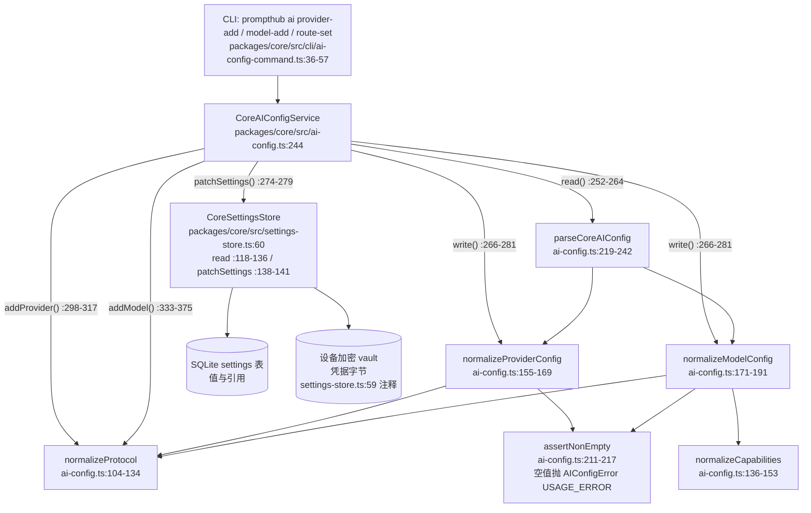
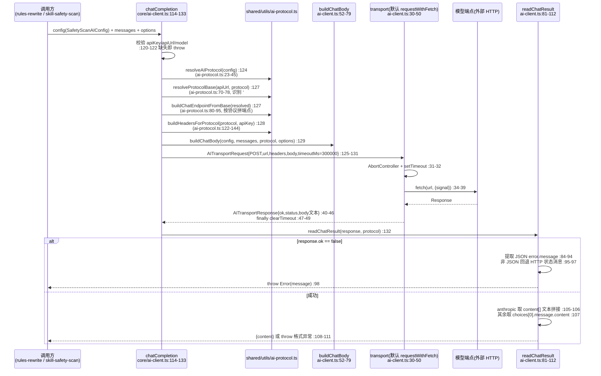
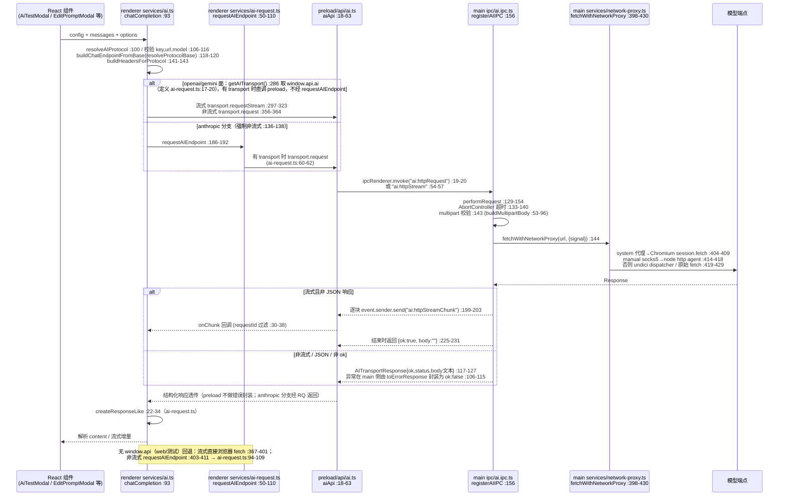
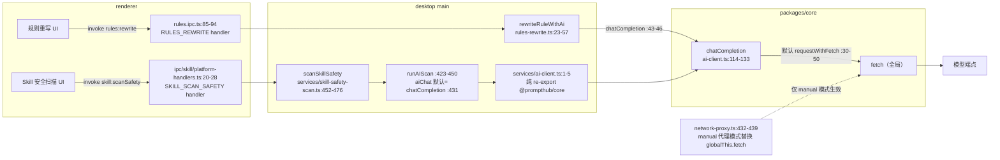
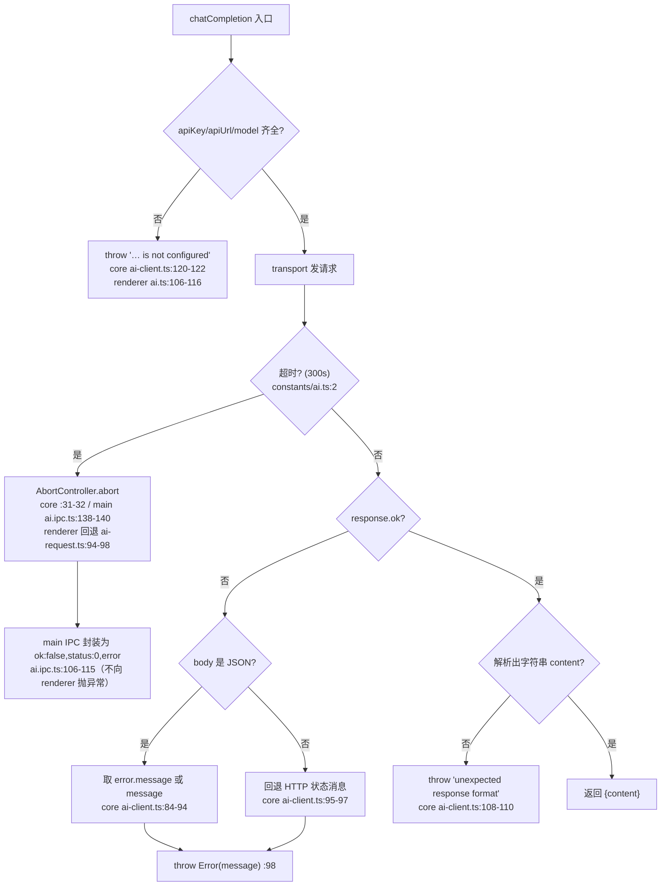

# AI Provider / 模型接入 · 现状流程图（flow）

> **派生 · 非权威 · 引用权威主题。** 本文是二开理解层的现状记录，不构成需求或实现约定。
> 权威需求与 API 基线见：[AI provider API 矩阵](../../reference/ai-provider-apis.md) · [系统规范](../../context/system.md) · [桌面行为](../../behavior/desktop.md)。
> 设计依据：[component-understanding-kb 设计](../../../changes/active/component-understanding-kb/design.md)。
> 证据基线：main @ `7e69e6f7` 工作区；所有 `文件:行号` 均经直接读码核对（graphify GRAPH(core)/GRAPH(shared)/GRAPH(desktop) 辅助邻居关系）。

## 0. 范围：必须先分清的两条线

P0 子系统代码里混着两条职责完全不同的线，读码前先分开：

| 线 | 职责 | 关键代码 | 是否直接调模型 API |
| --- | --- | --- | --- |
| **AI 模型 provider 线**（本文主体） | PromptHub 自己的 AI 功能（聊天测试、改写、翻译、安全扫描、规则重写等）向外部/本地模型端点发 HTTP 请求 | `packages/core/src/ai-client.ts`、`packages/core/src/ai-config.ts`、`packages/shared/utils/ai-protocol.ts`、desktop `ai.ipc.ts`、renderer `services/ai.ts` | 是 |
| **coding-agent 平台适配线**（P1 范畴，本文只划界） | 管理外部编码 CLI（Claude Code、Codex、Qwen Code 等）自己的配置文件与 provider 激活，不代替它们推理 | desktop `agent-model-*.ts`、`agent-provider-*.ts`、`agent-qwen-definition.ipc.ts` | 否（仅做连通性/模型探测） |

区分证据：

- `apps/desktop/src/main/ipc/agent-qwen-definition.ipc.ts:11-14` 只导入 `listQwenDefinitions` / `resolveQwenDefinitionPath`；`:48-60` 的请求校验限定 `agentId === "qwen"`、`kind` 为 `subagent`/`command`（`:72`）。它管理的是 **Qwen Code 编码 agent 的子代理/命令定义文件**，与本地 GGUF 推理无关。
- `apps/desktop/src/main/services/agent-qwen-definition-service.ts:4` 复用 `parseSkillMd` 解析定义文件 frontmatter，`:27-33` 是目录扫描限额——纯文件系统读取，无模型调用。
- `apps/desktop/src/main/services/agent-model-config.ts:1-34` 导入 jsonc-parser / smol-toml / yaml 与 `claude-config` 工具，`:54-57` 定义 `oh-my-pi-yaml-v1` 等适配器——它**写各编码 agent 的原生配置文件**（JSONC/TOML/YAML），不是发推理请求。
- `apps/desktop/src/main/services/agent-model-provider-adapter.ts:8-11` 经 core 的 `reconcileAgentProviderState` 做 provider 状态调和，`:26-31` 调 `agent-model-config` 的读写——属平台适配。
- coding-agent 线确实会发 HTTP，但只是**探测**：`agent-provider-connectivity.ts:10-15` 导入 SSRF 防护（`isBlockedHostname`/`isPrivateAddress`），`agent-provider-model-test.ts:61-67` 用独立的 5s 连接 / 8s 首 token / 20s 总超时，走 node `http/https`（`:1-2`），**不复用** AI provider 线的 transport 与 300s deadline。权威基线也明确该 300s 约束不适用于 Agent provider 探测（[ai-provider-apis.md](../../reference/ai-provider-apis.md) Stable Asset Rules）。

下文第 1–4 节全部属 AI 模型 provider 线。

## 1. Provider 配置归一化流（core）

### 1.1 流程图

### 1.2 叙述：为什么这么流

- **单一归一化入口**：无论配置来自 CLI 新增（`addProvider`/`addModel`）、整体写入（`write`）还是读取旧数据（`read` → `parseCoreAIConfig`），都会经过同一组 `normalize*` 纯函数。这保证落盘与读出的配置形状一致，协议字段永远是合法枚举。
- **协议推断**（`normalizeProtocol`，`ai-config.ts:104-134`）：显式 `apiProtocol` 为 `openai`/`gemini`/`anthropic` 之一时直接采用（`:109-115`）；否则按 provider 名/URL **子串**推断——含 `anthropic`/`claude` 或 `api.anthropic.com` → anthropic（`:119-125`），含 `gemini`/`google` 或 `generativelanguage.googleapis.com` → gemini（`:126-132`），兜底 openai（`:133`）。对 localhost/自定义端点没有任何特殊分支，一律落到 openai 兜底。
- **注意存在两份推断实现**：core 的 `normalizeProtocol`（子串匹配，含 `claude`/`google` 别名）与 shared 的 `resolveAIProtocol`（`packages/shared/utils/ai-protocol.ts:23-45`，provider **全等**匹配 `anthropic`/`google`/`gemini`）。运行时聊天以后者为准（见第 2 节）；配置归一化用前者。两者兜底都是 openai，但别名覆盖范围不同——这是现状事实，不是本文提出的改动。
- **数据所有权**：provider/model 配置以 `aiProviders`/`aiModels`/`modelRouteDefaults` 设置键持久化（`ai-config.ts:259-261` 读、`:275-278` 写）。SQLite 存值与凭据引用，设备加密 vault 存凭据字节（`settings-store.ts:59` 注释、`:60-90` 构造与迁移）；renderer 侧编解码见 `packages/core/src/renderer-settings-codec.ts:151`（encode）/`:206`（decode）。
- **路由能力校验**：`setRoute`（`ai-config.ts:398-412`）经 `assertRouteCompatible`（`:443-473`）拒绝能力不匹配的模型（如 visionText 必须 `capabilities.vision === true`），失败抛 `ROUTE_CAPABILITY_MISMATCH`。

## 2. 一次 chat 调用链（core `chatCompletion`）

### 2.1 时序图

### 2.2 协议分支差异（body 构造与结果解析）

端点拼装（`buildChatEndpointFromBase`，`ai-protocol.ts:80-95`）：

| 协议 | 端点规则 | 证据 |
| --- | --- | --- |
| openai | base 以 `/v数字` 结尾 → `+ /chat/completions`，否则 `+ /v1/chat/completions` | `ai-protocol.ts:92-94` |
| anthropic | 已以 `/messages` 结尾则原样；`/v数字` 结尾 → `+ /messages`；否则 `+ /v1/messages` | `ai-protocol.ts:86-91` |
| gemini | 走 **OpenAI 兼容端点**：`/openai` 结尾 → `+ /chat/completions`；`/v数字(beta)` 结尾 → `+ /openai/chat/completions`；否则 `+ /v1beta/openai/chat/completions` | `ai-protocol.ts:85`、`:97-103` |
| 任意协议 + `apiUrl` 以 `#` 结尾 | `resolveProtocolBase` 置 `explicit=true`（`:74-77`），端点**原样使用**不再拼装（`:84`） | `ai-protocol.ts:70-78`、`:84` |

base 提取前先剥离已知端点后缀（`/chat/completions`、`/completions`、`/models`、`/embeddings`、`/images/generations`，`ai-protocol.ts:15-21`、`getBaseUrl :47-58`），所以用户填完整端点或 base 都能工作。

body 构造（`buildChatBody`，`ai-client.ts:52-79`）：

| 维度 | openai / gemini | anthropic |
| --- | --- | --- |
| model 名 | gemini 剥掉 `models/` 前缀（`:58`） | 原样 |
| system 消息 | 留在 `messages` 数组里（`:72-73`） | 抽出为顶层 `system` 字段，messages 过滤 system（`:60-69`） |
| temperature | 默认 0.3（`:74`） | **不发送** |
| max_tokens | 默认 4096（`:75`） | 默认 4096（`:63`） |
| response_format | 可选透传（`:77`） | 不支持 |
| stream | 恒 `false`（`:76`）——core 客户端只做非流式 | 恒 `false`（`:68`） |

请求头（`buildHeadersForProtocol`，`ai-protocol.ts:122-144`）：anthropic 用 `x-api-key` + `anthropic-version: 2023-06-01`（`:135-137`）；gemini 仅在 `useNativeGeminiAuth` 选项下用 `x-goog-api-key`（`:138-139`）——**core chatCompletion 未传该选项**（`ai-client.ts:128`），gemini 聊天走 OpenAI 兼容端点 + `Authorization: Bearer`（`:141`）；openai 同样 Bearer。

结果解析（`readChatResult`，`ai-client.ts:81-112`）：anthropic 取 `content[]` 中 `type === "text"` 的 `text` 拼接（`:105-106`）；openai/gemini 取 `choices[0].message.content`（`:107`）。取不到字符串则抛 "unexpected response format"（`:108-110`）。

### 2.3 叙述：为什么这么流

- **协议工具下沉 shared**：endpoint/鉴权/URL 标准化的唯一真相源是 `packages/shared/utils/ai-protocol.ts`，core 与 renderer 都复用（权威基线 [ai-provider-apis.md](../../reference/ai-provider-apis.md) Stable Asset Rules 明确要求三端复用）。core 与 renderer 各自维护 chat 编排，但协议拼装不重复实现。
- **transport 可注入**：`chatCompletion` 第 4 参默认 `requestWithFetch`（`ai-client.ts:118`），调用方可替换——这是测试与跨环境适配的边界。`AITransportRequest/Response` 是纯可序列化契约（`packages/shared/types/ai.ts:13-21`、`:25-32`），能安全跨 IPC。
- **gemini 走 OpenAI 兼容面**：避免在 core 客户端里实现原生 Gemini generateContent 协议，body/解析与 openai 共用一条分支，只有端点拼装与 model 前缀不同。
- **配置类型**：core 聊天入参是 `SafetyScanAIConfig`（定义在 `packages/shared/types/skill.ts:618-624`，含 provider/apiProtocol/apiKey/apiUrl/model 五字段；注意不在 `types/ai.ts`）。

## 3. 桌面跨进程边界（renderer ↔ preload ↔ main ↔ core）

桌面上有**两条并存的聊天执行路径**，共用 shared 协议工具，但编排代码不同：

### 3.1 路径 A：renderer 编排 + main 代理转发（交互式聊天主路径）

renderer 的 `chatCompletion`（`apps/desktop/src/renderer/services/ai.ts:93`）是功能更全的独立实现（流式、思考模式、`max_completion_tokens` 自动选择、自定义参数），**不调用 core 的 chatCompletion**，只复用 shared 协议工具（`ai.ts:8-13`）。

要点：

- IPC 通道定义：`packages/shared/constants/ipc-channels.ts:145-148`（`ai:httpRequest` / `ai:httpStream` / `ai:httpStreamChunk` / `ai:httpStreamError`）。
- **为什么绕 main 转发**：renderer 直接 fetch 受 CORS 与代理限制；main 的 `fetchWithNetworkProxy` 复用应用系统代理设置（`network-proxy.ts:402-409` 注释与分支），并统一做 multipart 输入校验（`ai.ipc.ts:53-96`：文件数 ≤4、单文件 ≤20MB、base64 校验、图片 MIME 白名单）。
- **流式边界**：main 把 SSE 字节逐块经 `ai:httpStreamChunk` 事件推回 renderer（`ai.ipc.ts:187-212`），preload 按 `requestId` 过滤后回调（`preload/api/ai.ts:30-48`），renderer 用 `ai-chat-stream` 状态机解析增量（`ai.ts:297-354`）。响应是 JSON 或非 ok 时退化为一次性返回（`ai.ipc.ts:179-185`）。
- **无 window.api 时的回退**（web/测试环境）：非流式经 `requestAIEndpoint`（`ai.ts:403-411`）落到浏览器 fetch + 自带 AbortController 超时（`ai-request.ts:94-109`）；流式在 `ai.ts:367-401` 直接浏览器 fetch + `handleStreamResponse`，不经 main。
- renderer 侧协议差异比 core 多：anthropic 强制非流式（`ai.ts:136-138`）并走独立分支（`:165-213`，经 `requestAIEndpoint :186-192` 发送）；openai 面按模型名决定 `max_completion_tokens` vs `max_tokens`（`:148-155`、`:217-221`）；Qwen/DashScope 模型注入 `enable_thinking`（`:237-254`）；gemini 不发 frequency/presence penalty（`:230-235`）。

### 3.2 路径 B：main 进程内直接走 core chatCompletion（后台 AI 功能）

要点：

- 这条路径**不经过 `ai.ipc.ts`**：core `chatCompletion` 用自带 `requestWithFetch`（裸 fetch + AbortController，`ai-client.ts:30-50`）。系统代理模式下 main 的裸 fetch 不走 Chromium 代理；仅 manual 代理模式通过替换 `globalThis.fetch`（`network-proxy.ts:432-439`）间接获得代理能力。这是两条路径的现状差异。
- `skill-safety-scan` 的 AI 配置由 renderer 随 `SkillSafetyScanInput.aiConfig` 传入（`platform-handlers.ts:22-26`），缺配置时在扫描入口就抛 `AI_NOT_CONFIGURED`（`skill-safety-scan.ts:458-462`）。
- `rules-rewrite` 在调 core 前先自查 apiKey（`rules-rewrite.ts:27-29`），并以 `responseFormat: json_object`、temperature 0.2/0.3 等参数调用（`skill-safety-scan.ts:442-446`、`rules-rewrite.ts:43-46`）。

## 4. 失败 / 恢复路径汇总

逐条说明（均已核对）：

| 失败点 | 行为 | 证据 |
| --- | --- | --- |
| apiKey / apiUrl / model 缺失 | core 入口三连 throw，错误消息区分字段 | `packages/core/src/ai-client.ts:120-122`；renderer 对应 `ai.ts:106-116` |
| 请求超时 | 统一 300s deadline（`AI_REQUEST_TIMEOUT_MS = 300_000`）；core 用 `setTimeout → controller.abort()`，`finally clearTimeout` | `packages/shared/constants/ai.ts:2`；`ai-client.ts:31-32`、`:47-49`；main 侧 abort 携带原因 `ai.ipc.ts:138-140` |
| 非 2xx + JSON 错误体 | 只提取 `error.message` / `message` 字符串向外暴露，不透传整个 provider JSON | `ai-client.ts:84-94` |
| 非 2xx + 非 JSON 错误体 | `JSON.parse` 抛错被 catch，保留 HTTP 状态消息（`response.error` 或 `AI API request failed (status)`） | `ai-client.ts:82-83`、`:95-97` |
| 2xx 但形状不符 | content 非字符串 → throw | `ai-client.ts:108-110` |
| main IPC 内任何异常（超时/网络/multipart 非法） | 封装 `{ok:false, status:0, error}` 返回，**不跨 IPC 抛异常**；流式另发 `ai:httpStreamError` 事件 | `ai.ipc.ts:106-115`、`:163-167`、`:213-220`、`:233-241` |
| renderer 错误展示 | 结构化 JSON → HTML 错误页标题 → 截断文本 三级回退；504 特判 | `ai-request.ts:165-192` |
| 配置非法（空字段/格式/路由能力） | `AIConfigError` 带 code：`USAGE_ERROR` / `INVALID_CONFIG` / `NOT_FOUND` / `ROUTE_CAPABILITY_MISMATCH` | `ai-config.ts:79-87`、`:211-217`、`:221-223`、`:324-326`、`:443-473` |
| 安全扫描未配置 AI | 入口抛 `AI_NOT_CONFIGURED`，静态扫描不受影响 | `skill-safety-scan.ts:456-467` |

恢复语义：core 与 renderer 的聊天调用都是**一次性失败即抛错，无自动重试**（renderer 的 token 参数回退重试属 Issue #21 的模型兼容逻辑，见 `ai.ts:145-155` 注释；coding-agent 探测线才有 `maxRetries`，`agent-provider-model-test.ts:67`）。超时后 `clearTimeout` 保证不泄漏定时器；AbortController 只中断本次请求，不影响后续调用。

## 5. 对二开（本地 Qwen3.5-9B GGUF）的现状阅读指引

只指出现状事实与阅读入口，方向与改动点留给 [architecture.md](architecture.md)（已建，Task 4）与 [todo.md](todo.md)（已建，Task 5），不在此预设接口：

- 本地 OpenAI 兼容端点会自然落入现有 openai 分支：协议推断兜底 openai（`ai-config.ts:133`、`ai-protocol.ts:44`），端点拼装支持任意 base 与 `#` 显式端点（`ai-protocol.ts:80-95`）。
- 现状的硬摩擦点：core 与 renderer 聊天入口都**强制要求非空 apiKey**（`ai-client.ts:120`、`ai.ts:106-108`），而本地推理端点通常无 key。
- 超时现状为固定 300s（`constants/ai.ts:2`），core 路径不可按调用覆盖（`ai-client.ts:130` 写死），renderer 路径可经 `options.timeoutMs` 覆盖（`ai.ts:104`）。
- 与本地 GGUF 无关的旁路：`agent-qwen-definition.ipc.ts` 及 `agent-model-*`/`agent-provider-*` 属 coding-agent 平台适配线（第 0 节），不要在那里找推理接入点。

## 附：本文证据文件清单

- `packages/core/src/ai-client.ts`（133 行，全文读）
- `packages/core/src/ai-config.ts`（476 行，全文读）
- `packages/core/src/rules-rewrite.ts`、`packages/core/src/settings-store.ts`（节选）、`packages/core/src/cli/ai-config-command.ts`（节选）
- `packages/shared/utils/ai-protocol.ts`（144 行，全文读）、`packages/shared/types/ai.ts`（全文读）、`packages/shared/types/skill.ts:618-624`、`packages/shared/constants/ai.ts:2`、`packages/shared/constants/ipc-channels.ts:145-148`
- `apps/desktop/src/main/ipc/ai.ipc.ts`（244 行，全文读）、`rules.ipc.ts`（节选）、`ipc/skill/platform-handlers.ts`（节选）、`agent-qwen-definition.ipc.ts`（节选）
- `apps/desktop/src/main/services/ai-client.ts`、`skill-safety-scan.ts`（节选）、`network-proxy.ts`（节选）、`agent-model-config.ts` / `agent-model-provider-adapter.ts` / `agent-provider-connectivity.ts` / `agent-provider-model-test.ts` / `agent-qwen-definition-service.ts`（各节选，用于划界）
- `apps/desktop/src/preload/api/ai.ts`（全文读）
- `apps/desktop/src/renderer/services/ai.ts`（节选 :1-423）、`ai-request.ts`（全文读）
- graphify 邻居核对：GRAPH(core) `chatCompletion`（5 连接：rules-rewrite imports/calls、buildChatBody、readChatResult）、`normalizeProtocol`（addProvider/addModel/normalizeModelConfig/normalizeProviderConfig 等）；GRAPH(shared) `resolveAIProtocol`（ai-protocol 全家族）；GRAPH(desktop) `registerAIIPC`/`performRequest`（fetchWithNetworkProxy、requestToResponse、buildMultipartBody、toErrorResponse）。